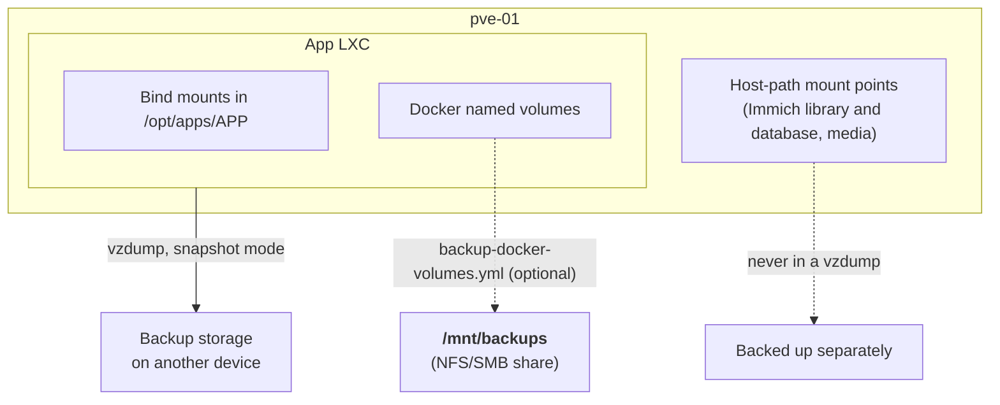

# Backup Strategy

This document describes how the data of the managed applications is backed up and restored.

## Overview

There are two layers, and the first one is the backup of record:

1. **Proxmox backups of each guest.** Every app runs in its own LXC on pve-01. A Proxmox backup
   (vzdump) or a ZFS snapshot of a guest captures its whole disk: the app directory under
   `/opt/apps/<app>` with its bind mounts, Docker's named volumes, and the images.
2. **The Ansible volume playbook (optional).** `backup-docker-volumes.yml` archives an app's Docker
   **named volumes** to `/mnt/backups`, on demand. It skips bind mounts, so it is never a full
   backup of an app on its own.

Apps keep their state in bind mounts under `/opt/apps/<app>` or in named volumes, and layer 1 covers
both the same way. Choose by convenience: a bind mount for files you edit or browse, a named
volume where nobody needs hand access. Don't move data between the two for backup coverage.

### Architecture



## Proxmox Backups (System of Record)

### What a guest backup misses

Proxmox never includes **host-path mount points** (`mpX: /rpool/...,mp=...`) in a container
backup, whatever the job settings. These need their own backup:

| Data | Mount point (pve-01 → guest) | Guests | Coverage |
|---|---|---|---|
| Immich photo library | `/rpool/data/immich/library` → `/mnt/immich/library` | immich | Backed up by hand, separately. Also holds Immich's nightly database dumps in `backups/` (`immich-db-backup-*.sql.gz`) |
| Immich Postgres data | `/rpool/data/immich/postgres` → `/mnt/immich/postgres` | immich | Through those nightly dumps. Restore from a dump rather than copying this folder |
| Media | `/rpool/data/media` → `/mnt/data` | jellyfin, arr, mediamanager | None by default |

Check with `pct config <vmid> | grep ^mp` on pve-01.

### Consistent copies

- **Snapshot mode.** On ZFS, `vzdump --mode snapshot` backs up a running guest from one instant.
  Databases recover from that like from a power cut.
- **No rsync of a running database.** A copy of a live Postgres folder or SQLite file (Jellyfin,
  the arr apps, ConvertX) can be torn mid-write. Stop the app first
  (`docker compose stop`), or copy from a ZFS snapshot.
- **Another device.** A backup stored on `rpool` (Proxmox's `local` storage lives there) dies
  with that pool. Send backups to Proxmox Backup Server, a NAS or a USB disk.

### Recommended job

In the Proxmox UI, **Datacenter → Backup → Add**:
- Selection: all guests.
- Mode: snapshot. Compression: zstd.
- Storage: one on a device other than `rpool`.
- Retention: for example keep-daily 7, keep-weekly 4, keep-monthly 3.

Restore a guest with **Restore** on its backup in the storage view, or `pct restore` on the CLI.
Mount-point data is not in it (see above).

## Ansible Volume Playbook (Optional)

### Directory Structure Example

```text
/mnt/backups/
├── n8n/
│   ├── db_storage_*.tar.gz
│   ├── n8n_storage_*.tar.gz
│   └── redis_storage_*.tar.gz
├── odoo/
│   ├── db_data_*.tar.gz
│   └── odoo_data_*.tar.gz
└── stirling-pdf/
    └── data_*.tar.gz
```

### Usage

```bash
# Run from deployer.vm
cd ~/git/server-hub/ansible

# Backup all apps on all hosts
ansible-playbook playbooks/backup-docker-volumes.yml

# Backup specific application
ansible-playbook playbooks/backup-docker-volumes.yml -e "app_name=n8n"

# Backup all apps on specific host
ansible-playbook playbooks/backup-docker-volumes.yml -l n8n.vm

# Custom backup destination
ansible-playbook playbooks/backup-docker-volumes.yml -e "backup_destination=/mnt/nas/backups"

# Custom retention count (default: 3 backups per volume)
ansible-playbook playbooks/backup-docker-volumes.yml -e "backup_keep_count=5"
```

### What Gets Backed Up

For each application:

| Item | Description |
|------|-------------|
| Docker Volumes | All named volumes defined in compose.yaml |

The playbook selects volumes with `docker volume ls --filter name=^<project>_`. **Bind mounts are
skipped silently**, so files an app keeps under `/opt/apps/<app>` are only in the Proxmox backup.

> **Note:** Configuration files (`compose.yaml` and `.env`) are **NOT** backed up by this playbook. They are stored in GitHub (with [SOPS](https://github.com/getsops/sops) encryption for `.env`). To restore config files, use the deploy playbook.

### Retention Policy

By default, only the **last 3 backups per volume** are retained. Older backups are automatically deleted after each backup run. This prevents disk space from filling up while maintaining recent restore points.

To customize: `-e "backup_keep_count=5"`

### Backup Process

1. **Stop** the application stack gracefully
2. **Create** tar.gz archives of each Docker volume using `alpine:3.23.2`
3. **Start** the application stack
4. **Verify** services are healthy:
   - Uses `community.docker.docker_compose_v2` with `wait: true`
   - Waits for all services with a healthcheck to become `healthy`
   - Timeout is configurable via `docker_compose_wait_timeout` (default: 90s)
5. **Cleanup** backups older than retention period
6. **Notify** via Telegram (using shared `load-telegram-credentials.yml` task)

### Backup File Naming

```
/mnt/backups/{app_name}/{volume_name}_{timestamp}.tar.gz

Example:
/mnt/backups/n8n/n8n_db_storage_20260106T143000.tar.gz
/mnt/backups/n8n/n8n_n8n_storage_20260106T143000.tar.gz
/mnt/backups/n8n/n8n_redis_storage_20260106T143000.tar.gz
```

---

## GitHub Actions Workflows

Manual workflows are available to trigger backups and restores from GitHub Actions.

### Backup Workflow

1. Go to **Actions** → **Backup Docker Volumes**
2. Click **Run workflow**
3. Select the application to backup (or "all")
4. Optionally specify a target host
5. Click **Run workflow**

#### Backup Inputs

| Input | Description | Default |
|-------|-------------|---------|
| `app_name` | Application to backup | Required |
| `target_host` | Specific host (e.g., n8n.vm) | All hosts |
| `backup_destination` | Backup path | `/mnt/backups` |

### Restore Workflow

⚠️ **WARNING:** Restore will OVERWRITE existing data!

1. Go to **Actions** → **Restore Docker Volumes**
2. Click **Run workflow**
3. Select the application to restore
4. Choose operation:
   - `list_backups` - View available backups
   - `restore_latest` - Restore most recent backup
   - `restore_specific` - Restore specific timestamp
5. For `restore_specific`, enter the backup timestamp
6. Click **Run workflow**

#### Restore Inputs

| Input | Description | Default |
|-------|-------------|---------|
| `app_name` | Application to restore | Required |
| `operation` | list_backups, restore_latest, restore_specific | list_backups |
| `backup_timestamp` | Timestamp for restore_specific (format: `YYYYMMDDThhmmss`, e.g., `20260106T143000`) | - |
| `backup_source` | Backup source path | `/mnt/backups` |

> **Security:** The restore workflow validates timestamp format with regex `^[0-9]{8}T[0-9]{6}$` and rejects paths containing `..` to prevent path traversal attacks.

### Required Secrets

Both workflows use the same secrets as the deploy workflow:

- `DEPLOYER_SSH_KEY` - SSH key to access deployer.vm
- `DEPLOYER_HOST` - Hostname of deployer.vm
- `DEPLOYER_USER` - Username on deployer.vm
- `DEPLOYER_SSH_KNOWN_HOSTS` - Known hosts entry

---

## Restore Playbook (CLI)

### Usage

```bash
# List available backups for an app
ansible-playbook playbooks/restore-docker-volumes.yml \
  -e "app_name=n8n" \
  -e "list_only=true"

# Restore latest backup
ansible-playbook playbooks/restore-docker-volumes.yml -e "app_name=n8n"

# Restore specific backup by timestamp
ansible-playbook playbooks/restore-docker-volumes.yml \
  -e "app_name=n8n" \
  -e "backup_timestamp=20260106T143000"

# Auto-confirm (for automation)
ansible-playbook playbooks/restore-docker-volumes.yml \
  -e "app_name=n8n" \
  -e "auto_confirm=true"
```

### Restore Process

1. **List** available backups with timestamps
2. **Validate** backup files exist (fails early if none found)
3. **Confirm** restore action (unless auto_confirm=true)
4. **Stop and remove** the application stack (`docker compose down`)
5. **Clear** existing volume data (using safe `find -exec rm` pattern)
6. **Extract** backup archives to volumes using `alpine:3.23.2`
7. **Start** the application stack
8. **Verify** services are healthy:
   - Uses `community.docker.docker_compose_v2` with `wait: true`
   - Waits for all services with a healthcheck to become `healthy`

> **Error Recovery:** The restore process is wrapped in a block/rescue structure. If restoration fails, it automatically attempts to restart services and notifies via Telegram.

---

## Modular Task Architecture

The backup and restore playbooks share common functionality with the deploy playbook through reusable task files:

### Shared Task Files

| Task File | Purpose |
|-----------|---------|
| `tasks/load-telegram-credentials.yml` | Load Telegram bot credentials from `~/.deploy-secrets` |

### Benefits

- **Code reuse:** Credential loading (~25 lines) written once, used by backup, restore, and deploy playbooks
- **Maintainability:** Bug fixes and improvements automatically apply to all playbooks

### Usage in Playbooks

```yaml
# Include Telegram credential loading
- name: Load Telegram credentials
  ansible.builtin.include_tasks: tasks/load-telegram-credentials.yml
```

---

## Setup Requirements

### 1. Mount Backup Share

On each Docker host, mount the shared backup location:

```bash
# Create mount point
sudo mkdir -p /mnt/backups

# NFS mount
echo "nas.local:/volume1/backups /mnt/backups nfs defaults,_netdev 0 0" | sudo tee -a /etc/fstab

# Or SMB/CIFS mount
echo "//nas.local/backups /mnt/backups cifs credentials=/root/.smbcreds,_netdev 0 0" | sudo tee -a /etc/fstab

# Mount
sudo mount -a

# Verify
df -h /mnt/backups
```

### 2. Telegram Notifications (Optional)

Create `~/.deploy-secrets` on deployer.vm:

```bash
export TELEGRAM_BOT_TOKEN="your-bot-token"
export TELEGRAM_CHAT_ID="your-chat-id"
```

---

## Scheduling the Playbook

### Option 1: GitHub Actions

Use the **Backup Docker Volumes** workflow from the GitHub Actions UI for on-demand backups.

For scheduled backups, add a `schedule` trigger to `.github/workflows/backup.yml`:

```yaml
on:
  schedule:
    # Daily at 3 AM UTC
    - cron: '0 3 * * *'
  workflow_dispatch:
    # ... existing inputs
```

### Option 2: Cron on Deployer VM

```bash
# Edit crontab on deployer.vm
crontab -e

# Daily backup at 3 AM
0 3 * * * cd ~/git/server-hub/ansible && ansible-playbook playbooks/backup-docker-volumes.yml >> ~/logs/backup.log 2>&1
```

### Option 3: n8n Workflow

Create an n8n workflow that:

1. Triggers daily via Schedule node
2. Runs the backup playbook via SSH Execute node
3. Sends notification on completion/failure

### Option 4: systemd Timer

Create `/etc/systemd/system/docker-backup.timer`:

```ini
[Unit]
Description=Daily Docker Volume Backup

[Timer]
OnCalendar=*-*-* 03:00:00
Persistent=true

[Install]
WantedBy=timers.target
```

---

## Disaster Recovery

### Scenario: Host VM Lost

Restore the guest from its latest Proxmox backup (see [Recommended job](#recommended-job)).
That brings back bind mounts and named volumes together. Then restore any mount-point data
separately.

Without a Proxmox backup, rebuild from Git and the playbook archives:

1. Create new VM with same hostname
2. Install Docker and configure user
3. Mount backup share
4. Run deploy playbook to recreate app directory
5. Run restore playbook to recover data

```bash
# On new VM
sudo mkdir -p /mnt/backups
sudo mount -t nfs nas.local:/volume1/backups /mnt/backups

# On deployer.vm
ansible-playbook playbooks/deploy-docker-app.yml -e "app_name=n8n"
ansible-playbook playbooks/restore-docker-volumes.yml -e "app_name=n8n" -e "auto_confirm=true"
```

### Scenario: Corrupted Data

1. List available backups
2. Choose backup before corruption
3. Restore specific timestamp

```bash
# Find last good backup
ansible-playbook playbooks/restore-docker-volumes.yml -e "app_name=n8n" -e "list_only=true"

# Restore specific backup
ansible-playbook playbooks/restore-docker-volumes.yml \
  -e "app_name=n8n" \
  -e "backup_timestamp=20260105T030000"
```

---

## Monitoring

### Check Last Backup

```bash
# List latest backups for all apps
find /mnt/backups -name "*.tar.gz" -mtime -1 -ls
```

### Verify Backup Integrity

```bash
# Test extracting a backup without writing
tar -tzf /mnt/backups/n8n/n8n_db_storage_20260106T143000.tar.gz > /dev/null && echo "OK"
```

### Space Usage

```bash
du -sh /mnt/backups/*/
```

---

## Security Considerations

1. **SOPS-encrypted secrets**: Environment files are stored in GitHub encrypted with SOPS, not in backups
2. **Restricted permissions**: Backup directories use mode 0750
3. **Network security**: Ensure NFS/SMB share is only accessible from Docker hosts
4. **Retention policy**: Old backups automatically deleted after retention period

---

## Troubleshooting

### Backup Fails with "Volume not found"

```bash
# Check actual volume names
docker volume ls | grep <app_name>

# Volume names include project prefix
# e.g., "n8n_db_storage" not just "db_storage"
```

### Restore Fails with "Permission denied"

```bash
# Ensure backup mount is writable
touch /mnt/backups/test && rm /mnt/backups/test

# Check Docker socket permissions
ls -la /var/run/docker.sock
```

### Services Don't Start After Restore

```bash
# Check container logs
cd /opt/apps/<app_name>
docker compose logs

# Common issue: database needs time to recover
docker compose restart
```
